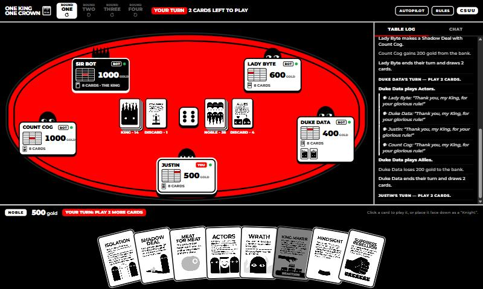

# One King One Crown — online

A real-time multiplayer browser version of **[One King One Crown](https://onecrown.store/)**, the
social manipulation card game where you scheme, betray and fight for the throne. Play with 4–8
friends from anywhere. Empty seats can be filled with bots.

- All **99 cards** (74 Noble, 25 King) with their official text and art. The art comes from the
  publisher's free print-and-play edition.
- All the official rules and Royal Advisor FAQ rulings. The few calls this version makes where
  the rules are silent are listed in [docs/RULES-DECISIONS.md](docs/RULES-DECISIONS.md).
- The server enforces every rule and sends each player only what they're allowed to see (your
  hand, your face-down Knights). Reconnect with a refresh. Autopilot covers anyone who drops out.

The look follows the printed game and its box: signal red, black and white, Montserrat, and
the faceless hooded figures. Each player sits at the table as a figure whose eyes follow the
action.



**New to the game?** Each player can switch on the guide in the lobby (it's on by default until
you've finished a game on that device). The guide gives a short spotlight tour of the screen before
round one (the game waits for everyone who chose it), one-time tips the first time something
happens, and a line above your hand that says what to do next. Only that player sees it. The
"How to play" page doesn't list the cards; finding them is part of the fun.

More in [docs/screenshots](docs/screenshots): home, lobby, card actions, negotiation, a new
King, game over and the phone layout.

## Play locally

```bash
npm install
npm start          # http://localhost:3000
```

Open the page, enter a name, **Create a game**, and share the 4-letter code or the invite link.
The host can add bots and starts the game once there are 4–8 players.

## Play with friends far away

Friends need to reach your server over the internet. Pick one option:

1. **Host it (recommended).** Deploy this repo to any Node host that supports WebSockets, such
   as Render, Railway or Fly.io. Build: `npm install`. Start: `npm start`. The server reads `PORT`
   from the environment. Run a single instance: games live in memory, so a restart ends the
   games in progress.
2. **Tunnel from your computer.** Run `npm start`, then expose it, for example with
   `cloudflared tunnel --url http://localhost:3000`, and send friends the URL it prints. Keep
   your computer awake while you play.

Use a voice call too: many cards ask you to say things out loud.

## Tests

```bash
npm test
```

- `test/rules.js` has 31 scripted scenarios for specific rules: Betrayal and Knights, Isolation,
  King Maker, crown swaps, Helping Hand, bets, negotiation caps, and more.
- `test/sim.js` plays hundreds of complete bot games. After every card it checks that gold stays
  within 0–2000, all 99 cards are accounted for, nobody holds the wrong deck, and hands are
  topped up.
- `test/multiplayer.js` starts the real server and connects 5 socket clients. It checks hidden
  information, out-of-turn play, reconnect tokens and a full game played to the end.

## Project layout

```
server/game.js     rules engine (rounds, turns, prompts, gold, crown changes, negotiation)
server/cards.js    every card: text, copies, restrictions, effect
server/bot.js      bot / autopilot player
server/room.js     lobby, players, reconnection, per-player state broadcast
server/index.js    Express + Socket.IO server
public/            browser client (vanilla JS) and card art
tools/extract_art.py   re-extracts card art from the official print-and-play PDF
docs/              research dossier and rules decisions
```

## License & credit

One King One Crown is © its creators and published by Yancey Intl. under
[CC BY-NC-SA 4.0](https://creativecommons.org/licenses/by-nc-sa/4.0/). This fan-made online
version, including its code, is shared under the same license: **non-commercial**, credit the
original, and share alike. It is not affiliated with or endorsed by the publisher. If you enjoy
it, buy the real game at **[onecrown.store](https://onecrown.store/)**.
